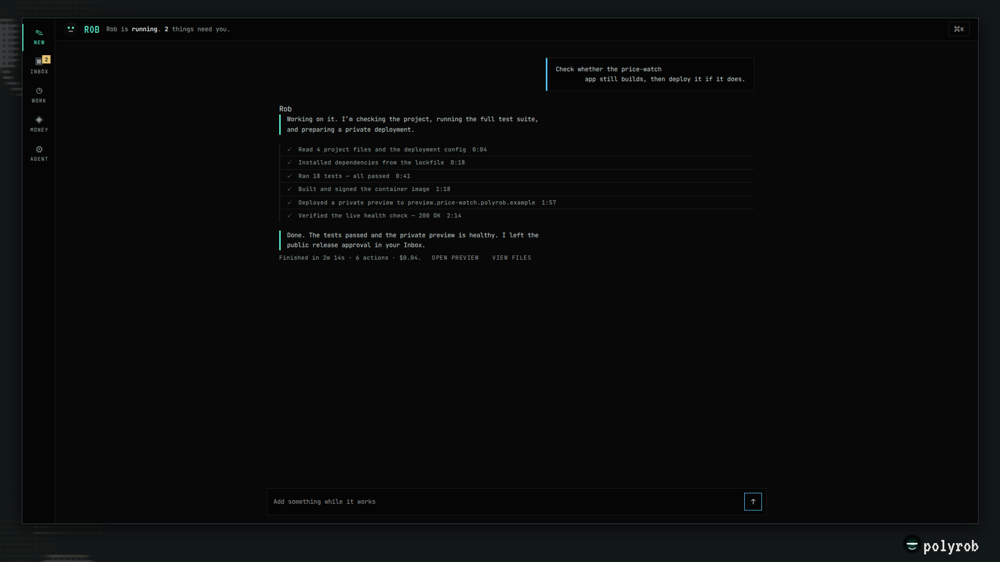

<div align="center">

<a href="https://polyrob.dev"></a>

### A self-hosted AI agent that works toward your goals, on your own machine.

[](https://github.com/theselfruleorg/polyrob/blob/main/LICENSE)
[](https://www.python.org/downloads/)
[](https://pypi.org/project/polyrob/)
[](https://github.com/theselfruleorg/polyrob/actions)
[](https://github.com/theselfruleorg/polyrob)

**[Quick Start](#quick-start) · [Docs](#documentation) · [Examples](https://github.com/theselfruleorg/polyrob/blob/main/docs/examples.md) · [Comparison](https://github.com/theselfruleorg/polyrob/blob/main/docs/comparison.md)**

</div>

POLYROB is an AI agent you run yourself. Give it a task or a standing goal in plain language: it
plans the steps, uses tools (web, files, code, a shell, mail, MCP servers), recovers from its own
errors, and reports back — in your terminal, a web console, a REST API, or a chat app such as
Telegram or email.

It is for people who want an agent that keeps working between messages and whose data stays on
their own box. The agent loop and the LLM layer are native code (no third-party agent framework),
memory and state are local SQLite files, and anything that spends money waits behind caps and your
approval.

> **Self-hosted, not a SaaS.** There is no hosted version. Your keys, your data, your machine;
> only the LLM calls (and the tools you turn on) leave it.

---

## Quick Start

On Linux, macOS or WSL2 (no Python 3.11+? The installer fetches a private copy):

```bash
curl -fsSL https://polyrob.dev/install.sh | bash
```

The script clones the source into `~/.polyrob/src`, builds a virtualenv, puts `polyrob` on your
`PATH` and starts the setup wizard. To read it first (recommended):

```bash
curl -fsSL https://polyrob.dev/install.sh -o install.sh && less install.sh && bash install.sh
```

Or from PyPI:

```bash
pipx install polyrob          # or: pip install polyrob   ("polyrob[all]" for every extra)
polyrob setup                 # provider key, model, persona, owner, autonomy, chat surface
polyrob doctor                # preflight: keys, the model it will pick, memory, health
polyrob                       # talk to the agent
```

Where things live:

| What | Where |
|---|---|
| Configuration and keys | `~/.polyrob/.env` |
| Data (memory, goals, sessions, skills) | `~/.polyrob/data`, for every process — set `POLYROB_DATA_DIR` to move it |
| Source and virtualenv (install script only) | `~/.polyrob/src`, `~/.polyrob/venv` |

Keep it running after you close the terminal:

```bash
polyrob service install       # a systemd user unit or a launchd agent
polyrob service restart       # or /restart from chat; it finishes the current work first
```

Update a git install with `polyrob update --apply` (snapshot, migrate, verify, automatic rollback);
for pip or pipx, `polyrob update` prints the command to run. Coming from 1.7.0? Read the
[1.7.1 note](https://github.com/theselfruleorg/polyrob/blob/main/docs/guide/upgrading.md#upgrading-to-171) first. Remove it with `polyrob uninstall`.
Full walkthrough: **[getting started](https://github.com/theselfruleorg/polyrob/blob/main/docs/guide/getting-started.md)** ·
**[upgrading](https://github.com/theselfruleorg/polyrob/blob/main/docs/guide/upgrading.md)**.

---

## What it does

**Works toward goals.** A durable goal board and scheduled jobs (`"every monday 09:00"`, `30m`,
cron syntax) keep work going between your messages and across restarts. Every unattended run stops
at one step cap and one spend cap and says why it stopped. When it needs you, it raises an action
card; once you decide, it carries on. → [Jobs, goals, decisions and pauses](https://github.com/theselfruleorg/polyrob/blob/main/docs/guide/streams.md)

**Learns from use.** It keeps cross-session memory, writes and retires its own skills, and wakes
itself to follow up on unfinished work. The CLI turns on the interactive tools by itself; the
learning and self-directed loops need one more switch, `polyrob autonomy on`. Every skill or
identity edit the agent writes waits in quarantine for your review.
→ [Skills](https://github.com/theselfruleorg/polyrob/blob/main/docs/guide/skills.md) · [the autonomy dial](https://github.com/theselfruleorg/polyrob/blob/main/docs/guide/configuration.md#6-the-autonomy-dial)

**Uses real tools.** Core ships web reading (`web_fetch`, no browser needed) and Playwright
automation, files, coding tools, git and GitHub, a persistent shell with background jobs, opt-in
code execution, the agent's own mailbox, an MCP client, and sub-agents with a narrowed toolset.
First-party **packs** add more and ship inside the same install: `discovery` (AnySite structured
data, Perplexity search), `x` (the agent's X account), `markets` (Polymarket, Hyperliquid) and
remote sandbox backends. → [Packs](https://github.com/theselfruleorg/polyrob/blob/main/docs/guide/packs.md) · [Architecture](https://github.com/theselfruleorg/polyrob/blob/main/docs/guide/architecture.md)

**You choose how much it may do.** `/mode` says what runs without asking; `/mode ask-first`,
`standard` or `on-my-own` sets one level.

**Meets you where you are.** The terminal (`polyrob`), a web console, a REST API with SSE, an
OpenAI-compatible `/v1` endpoint, the A2A agent protocol, an MCP server (off by default), and chat
surfaces: Telegram, email, WhatsApp, Discord, Slack, Signal, Feishu / Lark and DingTalk. Run every
enabled chat surface in one process with `polyrob gateway`.
→ [CLI](https://github.com/theselfruleorg/polyrob/blob/main/docs/guide/cli.md) · [Chat commands](https://github.com/theselfruleorg/polyrob/blob/main/docs/guide/chat-commands.md) · [API](https://github.com/theselfruleorg/polyrob/blob/main/docs/guide/api.md)

**Any model.** OpenAI, Anthropic, Google Gemini, DeepSeek, OpenRouter and NVIDIA NIM built in, plus
a catalog of other providers, OAuth subscription plans and any OpenAI- or Anthropic-compatible
endpoint you declare in `~/.polyrob/providers.yaml`. It fails over between providers, caches the
stable prompt prefix, and switches model live with `/model <name>` from the next step.
→ [Providers and models](https://github.com/theselfruleorg/polyrob/blob/main/docs/guide/configuration.md#4-providers-and-models)

### The console

<p align="center">
  
</p>

Chat, Inbox (only what needs you), Work (running, next, scheduled, apps), Money and Agent (identity,
memory, capabilities, health) in one owner surface over the same goal board, approval queue and
ledger as the CLI. Start it with `polyrob dashboard` and open `http://localhost:5050`.
→ [Console guide](https://github.com/theselfruleorg/polyrob/blob/main/docs/guide/console.md)

---

## Safety, as mechanisms

- **Untrusted input is data.** Web pages, mail and tool results reach the model inside an
  untrusted-content frame, never as instructions.
- **Strangers cannot steer it.** On a chat surface only the owner steers. A third party the agent
  contacted can only return data, and while that data is in the session the high-impact tools
  (money, outbound messages, code execution, delegation) are off until the owner's next turn. Group
  rooms get a read-only toolset unless you grant a bundle; money and owner data stay out. → [Owner controls](https://github.com/theselfruleorg/polyrob/blob/main/docs/guide/owner-controls.md) ·
  [Groups](https://github.com/theselfruleorg/polyrob/blob/main/docs/guide/groups.md)
- **Least-privilege sub-agents.** A delegated worker gets a narrowed toolset — no money, wallet,
  shell, code execution, raw HTTP or self-modification tools — and cannot delegate again.
- **Self-edits leave a trail.** New skills go live with a rollback; identity edits and anything from an untrusted session go to quarantine first.
- **Code execution needs a sandbox on a server.** It is off by default; the local subprocess
  backend is a convenience for your own machine, and a server refuses any backend that is not a
  sandbox (set `CODE_EXEC_BACKEND=docker`). Child processes never inherit your API keys.
- **A shell command guard.** Every shell line is classified: a floor nothing lifts, a dangerous
  class that waits for you, and unattended runs refuse it.
- **Bounded runs.** Step and spend caps on every autonomous run, sub-agents included.

The full model, including what each gate does not do: **[security model](https://github.com/theselfruleorg/polyrob/blob/main/docs/guide/security-model.md)**.
Defaults for every flag: **[docs/CONFIGURATION.md](https://github.com/theselfruleorg/polyrob/blob/main/docs/CONFIGURATION.md)**.

---

## Money and crypto *(optional)*

The agent can hold a wallet, pay for resources over x402, send invoices and detect their settlement
on-chain, read token and wallet data, and trade within a mandate you set. Read-only token data is on
by default; nothing that spends or signs is. Every outward payment is capped and goes through an
approval rail you control.

> ⚠️ **The crypto code is unaudited.** The wallet, signing and payment code (the `crypto` extra)
> has had no independent security audit, ships with no warranty, and can lose funds. Prefer
> testnets. See [SECURITY.md](https://github.com/theselfruleorg/polyrob/blob/main/SECURITY.md#crypto--wallet--payment-features).

→ [Payments](https://github.com/theselfruleorg/polyrob/blob/main/docs/guide/payments.md) · [Wallet](https://github.com/theselfruleorg/polyrob/blob/main/docs/guide/wallet.md) · [On-chain](https://github.com/theselfruleorg/polyrob/blob/main/docs/guide/onchain.md)

---

## Self-hosting

Three postures, chosen from how you bind the console: `local` (loopback), `own_ops` (a public host
with owner login) and `multitenant` (wallet sign-in and billing). `docker compose up` builds the
server, the browser and vector memory, and keeps data in a volume.
→ [Self-hosting](https://github.com/theselfruleorg/polyrob/blob/main/docs/guide/self-hosting.md) · [Deployment postures](https://github.com/theselfruleorg/polyrob/blob/main/docs/guide/deployment-postures.md)

---

## For developers

```bash
git clone https://github.com/theselfruleorg/polyrob
cd polyrob
bash install.sh                      # installs this tree: venv, editable install, wizard
# or by hand:
python -m venv venv && source venv/bin/activate
pip install -e ".[dev,all]"
pytest tests/unit -q
ruff check .
```

The layers: `agents/` (the agent loop), `modules/` (LLM, memory, database), `tools/`, `surfaces/`
(chat apps), `api/`, `cli/`, `webview/` (console), `cron/` (scheduled runs), `core/` (config,
policy, identity), `packs/` (first-party packs) and `polyrob/` (the pack SDK).
→ [Architecture](https://github.com/theselfruleorg/polyrob/blob/main/docs/guide/architecture.md) · [AGENTS.md](https://github.com/theselfruleorg/polyrob/blob/main/AGENTS.md) (contributor guide) ·
[CONTRIBUTING.md](https://github.com/theselfruleorg/polyrob/blob/main/CONTRIBUTING.md)

---

## Documentation

**Start**

| Page | What it covers |
|---|---|
| [Getting started](https://github.com/theselfruleorg/polyrob/blob/main/docs/guide/getting-started.md) | Install, first run, extras, where data lives |
| [CLI](https://github.com/theselfruleorg/polyrob/blob/main/docs/guide/cli.md) | Every `polyrob` shell command |
| [Chat commands](https://github.com/theselfruleorg/polyrob/blob/main/docs/guide/chat-commands.md) | Slash commands on the terminal, chat apps and the console |
| [Configuration](https://github.com/theselfruleorg/polyrob/blob/main/docs/guide/configuration.md) | Providers, memory, the autonomy dial, tools, surfaces, preferences |
| [FAQ](https://github.com/theselfruleorg/polyrob/blob/main/docs/guide/faq.md) | Short answers, and troubleshooting by the exact text you see |

**Use**

| Page | What it covers |
|---|---|
| [Jobs, goals, decisions and pauses](https://github.com/theselfruleorg/polyrob/blob/main/docs/guide/streams.md) | Standing work, the goal board, the inbox |
| [Owner controls](https://github.com/theselfruleorg/polyrob/blob/main/docs/guide/owner-controls.md) | Stop, pause, resume; approvals; first contact |
| [Conversation](https://github.com/theselfruleorg/polyrob/blob/main/docs/guide/conversation.md) | One conversation across phone, console and terminal |
| [Skills](https://github.com/theselfruleorg/polyrob/blob/main/docs/guide/skills.md) | Install, author and manage skills |
| [Packs](https://github.com/theselfruleorg/polyrob/blob/main/docs/guide/packs.md) | First-party and third-party packs |
| [Groups](https://github.com/theselfruleorg/polyrob/blob/main/docs/guide/groups.md) | Group chats: allowlist, roles, per-chat policy |
| [X (Twitter)](https://github.com/theselfruleorg/polyrob/blob/main/docs/guide/x-twitter.md) | The agent's X account |
| [Feishu / DingTalk](https://github.com/theselfruleorg/polyrob/blob/main/docs/guide/feishu-dingtalk.md) | The Feishu / Lark and DingTalk surfaces |
| [Console](https://github.com/theselfruleorg/polyrob/blob/main/docs/guide/console.md) | The web console |

**Run**

| Page | What it covers |
|---|---|
| [Operate the service](https://github.com/theselfruleorg/polyrob/blob/main/docs/guide/operate-the-service.md) | Start, stop, restart and update the background service |
| [Upgrading](https://github.com/theselfruleorg/polyrob/blob/main/docs/guide/upgrading.md) | Updates, snapshots, rollback, version notes |
| [Self-hosting](https://github.com/theselfruleorg/polyrob/blob/main/docs/guide/self-hosting.md) | Servers, Docker, units |
| [Deployment postures](https://github.com/theselfruleorg/polyrob/blob/main/docs/guide/deployment-postures.md) | `local`, `own_ops`, `multitenant` |
| [Profiles](https://github.com/theselfruleorg/polyrob/blob/main/docs/guide/profiles.md) | Several isolated agents on one machine |
| [Instances](https://github.com/theselfruleorg/polyrob/blob/main/docs/guide/instances.md) | Identity: SOUL, character, avatar |
| [Migration](https://github.com/theselfruleorg/polyrob/blob/main/docs/guide/migration/README.md) | Moving from another agent framework |

**Money**

| Page | What it covers |
|---|---|
| [Payments](https://github.com/theselfruleorg/polyrob/blob/main/docs/guide/payments.md) | Invoicing, settlement, credits, the ledger, the arming ladder |
| [Wallet](https://github.com/theselfruleorg/polyrob/blob/main/docs/guide/wallet.md) | The agent wallet, signer, caps, paying over x402 |
| [On-chain](https://github.com/theselfruleorg/polyrob/blob/main/docs/guide/onchain.md) | Token data, guarded transfers and swaps, the trading mandate |

**Reference**

| Page | What it covers |
|---|---|
| [API](https://github.com/theselfruleorg/polyrob/blob/main/docs/guide/api.md) | REST, A2A, OpenAI-compatible `/v1`, MCP server |
| [Architecture](https://github.com/theselfruleorg/polyrob/blob/main/docs/guide/architecture.md) | How the parts fit together |
| [Security model](https://github.com/theselfruleorg/polyrob/blob/main/docs/guide/security-model.md) | Each gate, and the OS or container boundary behind it |
| [Rails verification](https://github.com/theselfruleorg/polyrob/blob/main/docs/guide/rails-verification.md) | What counts as proof that a send landed |
| [docs/CONFIGURATION.md](https://github.com/theselfruleorg/polyrob/blob/main/docs/CONFIGURATION.md) | Every environment flag and its default |
| [Comparison](https://github.com/theselfruleorg/polyrob/blob/main/docs/comparison.md) · [Examples](https://github.com/theselfruleorg/polyrob/blob/main/docs/examples.md) | Other frameworks; real usage |
| [CHANGELOG](https://github.com/theselfruleorg/polyrob/blob/main/CHANGELOG.md) · [SECURITY](https://github.com/theselfruleorg/polyrob/blob/main/SECURITY.md) | Changes; reporting a vulnerability |

---

## Contributing and license

Contributions are welcome — see [CONTRIBUTING.md](https://github.com/theselfruleorg/polyrob/blob/main/CONTRIBUTING.md). Report vulnerabilities as
[SECURITY.md](https://github.com/theselfruleorg/polyrob/blob/main/SECURITY.md) describes. MIT licensed ([LICENSE](https://github.com/theselfruleorg/polyrob/blob/main/LICENSE)); name and brand use in
[TRADEMARK.md](https://github.com/theselfruleorg/polyrob/blob/main/TRADEMARK.md); third-party attributions in
[THIRD-PARTY-NOTICES.md](https://github.com/theselfruleorg/polyrob/blob/main/THIRD-PARTY-NOTICES.md).

<div align="center">

**POLYROB** — by [The Selfrule Organization](https://theselfrule.org)

</div>
